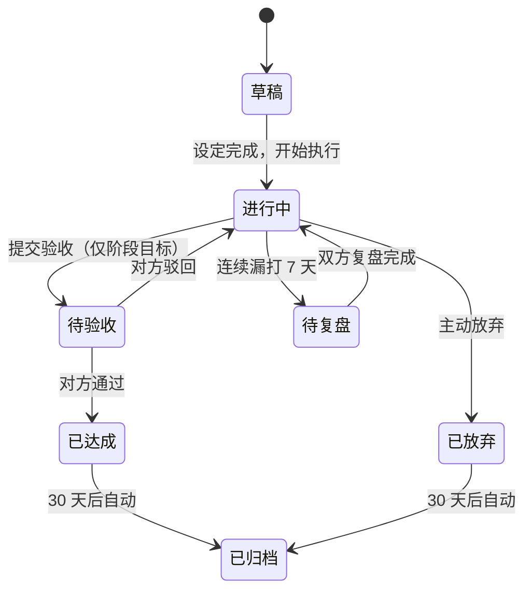
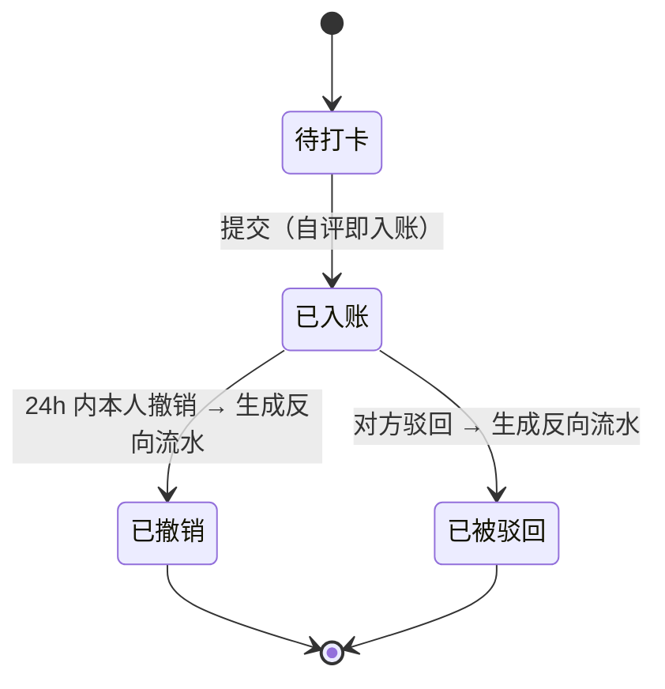
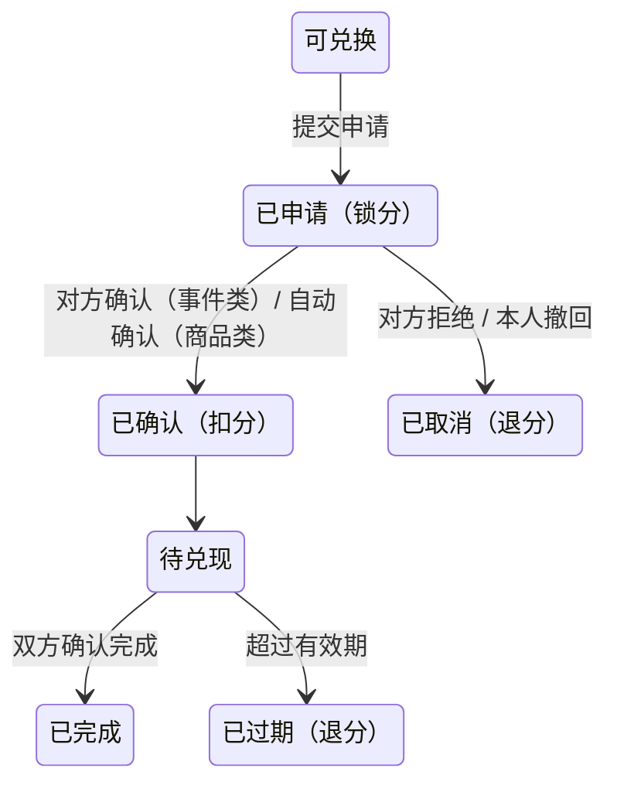
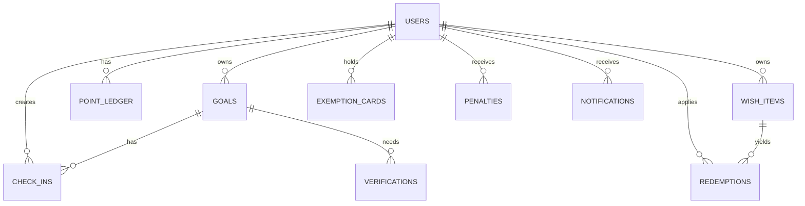

# 脚印 · 双人共享监督打卡与积分系统

> 需求文档 v0.1

| 项目 | 内容 |
|---|---|
| 文档版本 | v0.1（首版） |
| 日期 | 2026-11-02 |
| 状态 | 待评审 |
| 形态 | 自部署 Web 应用，移动端优先 |
| 参与者规模 | 2 人（1 对 1 互监） |

---

## 目录

1. [项目概述](#1-项目概述)
2. [设计原则](#2-设计原则)
3. [角色与权限](#3-角色与权限)
4. [目标模型](#4-目标模型)
5. [积分体系](#5-积分体系)
6. [打卡流程](#6-打卡流程)
7. [验收流程](#7-验收流程)
8. [软惩罚系统](#8-软惩罚系统)
9. [愿望单](#9-愿望单)
10. [统计与回顾](#10-统计与回顾)
11. [通知与提醒](#11-通知与提醒)
12. [数据模型](#12-数据模型)
13. [非功能性需求](#13-非功能性需求)
14. [版本规划](#14-版本规划)
15. [明确不做的事](#15-明确不做的事)
16. [待拍板清单](#16-待拍板清单)
17. [附录](#17-附录)

---

## 1. 项目概述

### 1.1 一句话定位

**一个只有两个人用的、彼此看得见的打卡与目标系统。**

它不解决"记录"问题——纸笔和表格都能记录。它解决的是**"没人看见"**：一个人定目标容易糊弄自己，两个人互相看得见，糊弄成本就变高了。

### 1.2 三根支柱

| 支柱 | 回答的问题 | 核心设计 |
|---|---|---|
| **目标** | 我要做什么？ | 分日常目标与阶段目标，五维自评量化"这件事值多少" |
| **积分** | 这件事值多少？ | 由时间成本、难度、频率、时段四项决定；连续天数另算里程碑奖金。1 元 ⇔ 10 积分锚定 |
| **愿望单** | 攒了能换什么？ | 商品（真金白银折算）与事件（对方的时间与让步） |

### 1.3 核心闭环

```
设目标 ──→ 打卡 ──→ 得积分 ──→ 攒够 ──→ 愿望单兑换 ──→ 对方兑现
  ↑                                            │
  └──────────── 对方可见 / 关键节点验收 ←────────┘
```

### 1.4 要解决的真实痛点

| 痛点 | 现状 | 本系统的应对 |
|---|---|---|
| 定了目标坚持不了 | 靠意志力，三天热度 | 连续链 + 对方可见 + 断链有代价 |
| 打卡变成自我表演 | 自己点自己，没有约束 | 日常目标自评，**阶段目标必须对方验收** |
| 努力没有回报感 | 做完就完了 | 量化成积分，能换到真东西 |
| 付出和回报不对等 | 凭感觉 | 五维自评 + 性价比提示，防止"累死给两分" |
| 监督变成催命 | 天天被问"做了没" | 系统承接提醒，人只负责验收和兑现 |

---

## 2. 设计原则

这四条原则用于裁决后续所有设计分歧。

**P1 · 摩擦最小**
打卡必须在 3 步内完成、10 秒内结束。任何"为了严谨"而增加的操作步骤，都要先问：不做这一步，最坏会怎样？如果最坏只是"可能有人虚报"，那就不做——虚报由对方驳回兜底，不靠流程防。

**P2 · 可见即可信**
系统的核心资产是"对方能看到"。所有数据默认对另一人完全可见（证据图片除外，见 3.4）。隐藏是例外，可见是默认。

**P3 · 只惩罚"没得到"，不惩罚"已拥有"**
所有惩罚都作用在"本可以得到但没得到"的积分上，绝不从已有余额里扣。积分永不为负。理由见 [8.4](#84-为什么不做扣存量)。

**P4 · 规则可调，默认值给死**
每条规则都有默认值，也都有开关或系数。默认值必须"能直接跑"，不能是"待定"。

---

## 3. 角色与权限

### 3.1 角色定义

系统只有两个账号，但**每个账号同时具备两种能力**：

- **打卡者**：对自己的目标打卡、提交验收、申请兑换
- **监督者**：查看对方进度、验收对方阶段目标、确认对方兑换申请

"我"和"对方"不是固定角色，而是相对关系。A 对 B 的目标是监督者，B 对 A 的目标也是监督者。

### 3.2 权限矩阵

| 操作 | 本人 | 对方 | 说明 |
|---|---|---|---|
| 创建/编辑自己的目标 | ✅ | ❌ | 对方可"质疑"，但不能直接改 |
| 删除自己的目标 | ⚠️ | ❌ | 只能"放弃"（保留记录），不能物理删除 |
| 打卡（自己的日常目标） | ✅ | ❌ | 代打卡不允许 |
| 撤销自己的打卡（24h 内） | ✅ | ❌ | 生成反向流水 |
| 提交阶段目标验收 | ✅ | ❌ | |
| 验收对方阶段目标 | ❌ | ✅ | 唯一必须由对方完成的操作 |
| 驳回任意一条打卡 | ❌ | ✅ | 监督者的兜底权力，见 6.5 |
| 查看对方目标与进度 | — | ✅ | 默认全可见 |
| 查看对方证据图片 | ✅ | ✅ | 双方可见，第三方不可见 |
| 管理愿望单（自己的） | ✅ | ❌ | |
| 确认对方兑换申请 | ❌ | ✅ | 事件类必须 |
| 调整积分（手动修正） | ⚠️ | ⚠️ | 需双方各自确认一次才生效 |

### 3.3 账号

- 仅支持 2 个账号，由首次部署时初始化
- 登录方式：昵称 + 口令（口令 ≥ 6 位，bcrypt 存储）
- 会话：Cookie / Token，有效期 30 天，可主动登出全部设备
- 不做注册、不做找回密码（忘了由部署者重置，见 13.5）

### 3.4 只读访客（可选，V0.3）

- 生成一个只读链接，可设置有效期（7 / 30 天）与随时撤销
- 访客可见：目标名称、完成率、连续天数、积分余额
- 访客**不可见**：证据图片、愿望单价格、兑换记录、任何备注文本

### 3.5 关系终止

任一方可以"退出共享"，效果：
- 双方转为各自独立的单人模式，历史数据保留
- 所有"待验收"项自动通过（避免卡死）
- 愿望单中未兑现的事件类兑换标记为"已失效"并退分
- 支持随时重新绑定（数据不丢）

---

## 4. 目标模型

### 4.1 两大类目标

| | 日常目标 | 阶段目标 |
|---|---|---|
| 本质 | 重复性习惯 | 一次性成果 |
| 例子 | 背单词、健身、早睡、练琴 | 写完论文初稿、考过科目二、做完一个项目 |
| 积分方式 | 每次打卡给分 | 完成后一次性给分 |
| 验收 | 自评即入账 | **必须对方确认** |
| 时间形态 | 长期 / 无终点的循环 | 有明确起止日期 |
| 连续链 | 有 | 无 |

### 4.2 日常目标字段

| 字段 | 类型 | 必填 | 默认 | 说明 |
|---|---|---|---|---|
| 名称 | 文本 ≤ 30 字 | ✅ | — | |
| 描述 | 文本 ≤ 200 字 | ❌ | 空 | 写清"做到什么算数" |
| 频率 | 枚举 | ✅ | 每日 | 每日 / 每周 N 次 / 指定星期 |
| 打卡窗口 | 时间段 | ❌ | 全天 | 如 06:00–08:00，影响时段系数 |
| 单次时长 | 整数（分钟） | ✅ | 30 | 用于算基础分 |
| 难度 | 1–5 | ✅ | 3 | 影响难度系数 |
| 开始日期 | 日期 | ✅ | 今天 | |
| 结束日期 | 日期 | ❌ | 无 | 留空 = 长期 |
| 提醒时间 | 时间 | ❌ | 目标窗口开始前 30 分钟 | |
| 每月补卡额度 | 整数 | ❌ | 2 | 见 6.4 |
| 状态 | 枚举 | 自动 | 草稿 | 见 4.5 |

**频率的具体规则**

| 频率 | 判定 | 频率系数 |
|---|---|---|
| 每日 | 每天都要打，漏一天即断链 | 1.0 |
| 每周 N 次（N=3,4） | 按自然周统计，周内打满 N 次即达标，不要求固定哪天 | 1.2 |
| 每周 N 次（N=1,2） | 同上 | 1.5 |
| 指定星期 | 只在选中的星期需要打，其余日子不计入也不断链 | 1.0 |

> 低频目标系数更高，是因为"一周只做一次还能坚持"的难度实际上高于"每天做"，且单次价值集中。

### 4.3 阶段目标字段

| 字段 | 类型 | 必填 | 默认 | 说明 |
|---|---|---|---|---|
| 名称 | 文本 ≤ 30 字 | ✅ | — | |
| 描述 | 文本 ≤ 500 字 | ✅ | — | 必须写清"完成的标准是什么" |
| 验收标准 | 文本 + 可选量化 | ✅ | — | 见 4.4 |
| 预估总时长 | 整数（分钟） | ✅ | 600 | 用于算总积分 |
| 难度 | 1–5 | ✅ | 3 | |
| 开始 / 截止日期 | 日期 | ✅ | 今天 / +30 天 | |
| 是否拆子任务 | 布尔 | ❌ | 否 | 开启后按子任务汇总积分 |
| 子任务列表 | 列表 | 条件 | — | 每项含名称、预估时长、难度 |
| 总积分 | 整数 | 自动 | — | 见 5.4 |
| 状态 | 枚举 | 自动 | 草稿 | |

**子任务规则**：开启后，子任务各自算积分并各自提交验收，全部子任务通过后目标才算达成；总积分 = 各子任务积分之和（不再单独计算）。

### 4.4 验收标准怎么写

文档层面强制一条规则：**验收标准必须能被"是 / 否"回答**。

| ❌ 不合格 | ✅ 合格 |
|---|---|
| "好好学英语" | "雅思模考达到 6.5 分，附成绩单截图" |
| "把论文写完" | "初稿全文 ≥ 8000 字，含 5 个章节标题，导出 PDF 提交" |
| "多运动" | "连续 4 周每周健身 3 次，附健身房打卡记录" |

可选量化指标（用于自动提示进度，不替代人工验收）：

| 指标类型 | 示例 | 用途 |
|---|---|---|
| 数值型 | 字数 ≥ 8000 | 提交时校验，不达标不给提交 |
| 次数型 | 完成 4 次 | 提交时显示"当前 3/4" |
| 产出物型 | 提交 1 个文件 / 1 张图 | 附件校验 |

### 4.5 目标状态机



- **草稿**：可随意编辑，不产生任何记录，不参与统计
- **进行中**：可编辑，但修改时长/难度会写入"变更记录"（对方可见）
- **已达成**：只读，进入成就列表
- **已放弃**：只读，保留历史打卡与已得积分，记入"放弃记录"
- **已归档**：30 天后自动归档，不再出现在首页，但可搜索到

### 4.6 五维自评（右上角"自行评判"的实现）

你的笔记里写了"不同小目标的评判维度（右上角标注：自行评判）"。落地方式是：**创建目标时，页面右上角有一个"评分说明"气泡，点开显示下面这张表；五维由本人填，系统只给建议值，对方可以质疑。**

| 维度 | 取值 | 是否影响积分 | 系统建议 |
|---|---|---|---|
| **时间成本** | 分钟数 | ✅ 直接决定基础分 | 按实际投入填，别按"感觉"填 |
| **难度** | 1–5 | ✅ 乘数 1.0–2.2 | 1=几乎无门槛，3=需要专门腾时间，5=需要长期专业投入 |
| **频率** | 每日/周 N 次/指定星期 | ✅ 乘数 1.0–1.5 | 越低频越高系数 |
| **时段敏感** | 是否设窗口 | ✅ 窗口内 1.1 / 窗口外 0.8 | 早起类、限时类必须设 |
| **性价比** | 自动计算，只读 | ❌ 仅提示 | 见 5.3，越界会提示 |

**"自行评判"的边界**：五维全部由本人填，系统只做两件事——把性价比算出来给双方看、把越界的标红。系统能自动发现的是"系数被手动改过"，发现不了"时长虚报"。后者靠对方的常识和驳回权兜底，而不是靠流程拦截。

这是有意的取舍：用流程防作弊会毁掉体验（每填一次都要证明），用可见性防作弊只花一次点击（对方一眼看过去就知道 5 分钟的事填了 60 分钟）。

---

## 5. 积分体系

### 5.1 积分的定位

积分**不是货币**，是"行为的度量尺"。它唯一的外部锚点是现金：**1 元 ⇔ 10 积分**。

这个锚点只用于两件事：
1. 商品愿望单的定价换算
2. 让人对"我这一个月值多少钱"有直观感受

积分**不可交易、不可转账、不可提现、不可赠送**（见 [15](#15-明确不做的事)）。

### 5.2 积分计算公式

所有系数在设置页可改，下表是默认值。

```
基础分 B = min(单次时长分钟 × 0.5, 60)

单次积分 = round( B × 难度系数 D × 频率系数 F × 时段系数 T )
```

**系数表**

| 系数 | 取值 | 默认 | 可调 |
|---|---|---|---|
| 基础分单价 | 分 / 分钟 | 0.5 | ✅ |
| 单次基础分封顶 | 分 | 60 | ✅ |
| 难度 D | 1→1.0 / 2→1.2 / 3→1.5 / 4→1.8 / 5→2.2 | 3→1.5 | ✅ |
| 频率 F | 每日 1.0 / 周3-4次 1.2 / 周1-2次 1.5 / 指定星期 1.0 | — | ✅ |
| 时段 T | 窗口内 1.1 / 无窗口 1.0 / 窗口外 0.8 | — | ✅ |

> 连续打卡的奖励**不在这张表里**——它不是乘数，是独立的里程碑奖金，见 [5.5 第二层](#55-与时间挂钩的三层含义)。

**三个算例**

| 目标 | 时长 | 难度 | 频率 | 时段 | 计算 | 单次得分 |
|---|---|---|---|---|---|---|
| 每天背单词 | 30 min | 2 (1.2) | 每日 (1.0) | 窗口内 (1.1) | 15 × 1.2 × 1.0 × 1.1 | **20** |
| 每周健身 3 次 | 60 min | 4 (1.8) | 周3次 (1.2) | 无窗口 (1.0) | 30 × 1.8 × 1.2 × 1.0 | **65** |
| 每天练琴 | 45 min | 3 (1.5) | 每日 (1.0) | 窗口外 (0.8) | 22.5 × 1.5 × 1.0 × 0.8 | **27** |

### 5.3 性价比：一眼看出"这目标定得划不划算"

**性价比 = 单次积分 ÷ (单次时长分钟 × 难度系数)**

| 区间 | 含义 | 系统行为 |
|---|---|---|
| < 0.35 | 给少了——累活给低价 | 创建时提示"要不要把时长或系数再核一下" |
| 0.35 – 0.85 | 正常 | 无提示 |
| > 0.85 | 给多了——可能刷分 | 标红，卡片显示"⚠ 偏高"，对方可见 |

**这个指标能做什么**：分子里的基础分 `B` 与分母里的"时长"同比例，`D` 也同时出现在两边，所以性价比实际等于 `0.5 × 频率系数 × 时段系数`。它衡量的是**这两项加成是否过头**，在创建目标时给一个"这配置合理吗"的即时反馈。

**这个指标不能做什么**：它看不出"5 分钟的事填成 60 分钟"——时长一涨，积分同比例涨，比值不变。虚报时长只能靠对方的常识和驳回权兜底（见 [4.6](#46-五维自评右上角自行评判的实现)）。这是有意的取舍，理由见原则 P1、P2。

### 5.4 阶段目标的积分

```
阶段目标积分 = round( 预估总时长分钟 × 0.5 × 难度系数 D )
封顶 1200 分
```

- 不使用频率/时段系数，也不参与连续里程碑（阶段目标没有"每天坚持"的概念）
- **必须对方确认**才生效（因为时长和难度都是自己估的，见 7.3）
- 一次性入账，不拆分（想拆就开子任务）
- 逾期未完成见 [8.2](#82-惩罚规则表)

**算例**：论文初稿预估 20 小时（1200 分钟），难度 4（1.8）→ 1200 × 0.5 × 1.8 = **1080 分**（≈108 元）

> 阶段目标单笔金额大，这是设计上有意为之：大成果要能换到大东西，否则没人愿意做长期投入。

### 5.5 "与时间挂钩"的三层含义

你的笔记写"同时可以与时间挂钩（包括积分本身）"。我把它拆成三层，分别落地：

**第一层 · 时段加成（已有）**
打卡发生在设定的时间窗口内，系数 1.1；窗口外 0.8。这鼓励"在对的时间做对的事"——早起、按时吃药、睡前阅读。

**第二层 · 连续打卡里程碑奖励**

连续达成**不改变单次得分**，而是在跨过门槛的那一刻，**额外发一笔**。这是加法，不是乘法。

| 连续达成 | 一次性奖励 | 累计到手 |
|---|---|---|
| 3 次 | +10 | 10 |
| 7 次 | +25 | 35 |
| 14 次 | +50 | 85 |
| 30 次 | +120 | 205 |
| 60 次 | +300 | 505 |
| 100 次 | +700 | 1205 |
| 365 次 | +3000 | 4205 |

**"连续次数"的计数单位**

| 目标频率 | 单位 | 例子 |
|---|---|---|
| 每日 | 天 | 连续 30 天 = 30 次 |
| 每周 N 次 | 达标周 | 连续 4 周都打满 N 次 = 4 次 |
| 指定星期 | 达标周 | 同上 |

> 周频目标按"周"不按"次"：若按次算，每周 3 次的目标打 12 次就摸到 14 次门槛，比每日目标轻松太多，不公平。

**断链**

- 漏打一次（或某周未达标）→ 连续计数归零，从 0 重新排
- 已领的里程碑奖励**不追回**
- 归零**不是扣分**，只是重新排队——这条很重要，见 [8.2](#82-惩罚规则表)

**发放时机**：达成的那次打卡提交后立即发放，生成独立流水 `streak_bonus`，UI 弹一次轻提示（不打断操作，3 秒自动消失）。

**为什么用里程碑而不是乘数**

| | 乘数（原方案） | 里程碑（现方案） |
|---|---|---|
| 感受 | 每次多 10%，几乎察觉不到 | "🔥 连续 30 天 +120"，有仪式感 |
| 断链的损失 | 未来收益变少，很抽象 | 明确的"我丢了那个 +120" |
| 数学 | 会污染性价比指标 | 性价比只反映频率和时段 |
| 早期反馈 | 第 1 天就有，但很小 | 第 3 天 +10，来得够快 |
| 公平性 | 老手每天多 25%，同样的 30 分钟比新手值钱 | 每天的分一样，奖励是额外叠加的 |

**结论：选里程碑。**

乘数唯一的优势是"平滑"——每天都有一点甜味，没有空窗。但在这个只有两个人的系统里，驱动行为的不是数字精度，是**"这件事值得说一句"**。乘数给不了这句话，里程碑能。

反过来看乘数的三个硬伤：
1. **感知不到**。每天多 2 分，混在一屏数字里根本看不见，等于没做。
2. **损失算不清**。"我断了所以以后少拿 10%"——抽象到无法心疼。而"我丢了那个 +120"是可以计价、会真的后悔的。
3. **新人吃亏**。第 1 天的人拿 1.0，第 30 天的人拿 1.25，同样是练 30 分钟，价值不同。里程碑方案下每天的分是公平的，奖励永远额外叠加。

**代价，以及为什么能接受**：里程碑之间的空窗（比如连到第 15–29 天什么都没有）。接受它，因为 14 天之后习惯基本已经形成，而且每天的打卡分、对方看得见、愿望单进度还在推着走，不靠这一个数字撑。

**如果以后想换回乘数**：把 [5.2](#52-积分计算公式) 的公式加回 `× S`（S 取 1.0 / 1.1 / 1.15 / 1.25），同时把本节这张里程碑表整块关掉。**两者绝不要同时开**——会双重奖励，通胀会失控。

**第三层 · 积分的时间价值（新增，默认关闭）**

| 机制 | 规则 | 默认 |
|---|---|---|
| 结余上限 | 余额超过 3000 分的部分，每月按 2% 衰减 | 关闭 |
| 月度清零 | 每月 1 日清零，防止囤积 | 关闭 |
| 有效期 | 积分获得后 12 个月过期 | 关闭 |

**为什么不默认开启**：这套系统的心理契约是"努力 → 有回报"。积分会蒸发会直接破坏这个契约，让人觉得"攒了也白攒"。只有当你们发现"余额越攒越多、什么都换得起、于是开始躺平"时，才需要打开它。这是**调节阀，不是默认规则**。

### 5.6 积分流水账模型

积分**不存余额字段**，只存流水，余额 = 求和。这是为了保证可审计、可撤销、可追溯。

| 流水类型 | 触发 | 方向 | 例子 |
|---|---|---|---|
| `checkin` | 打卡 | + | +20 背单词 |
| `streak_bonus` | 连续里程碑达成 | + | +120 连续 30 天 |
| `stage_credit` | 阶段目标通过 | + | +1080 论文初稿 |
| `redeem_lock` | 兑换申请（锁分） | 冻结 | 冻结 200（不计入可用余额） |
| `redeem_charge` | 兑换确认 | − | −200 兑换耳机 |
| `redeem_refund` | 取消 / 过期退分 | + | +200 退回 |
| `checkin_revoke` | 撤销打卡 | − | −20 撤销昨日打卡 |
| `penalty` | 惩罚扣减（仅作用于待发池） | − | 见 8.2 |
| `adjust` | 手动修正（双方确认） | ± | +50 补录 |

**规则**
- 余额 = 所有流水求和 + 当前冻结额（可用余额 = 求和）
- 撤销 = 新增一条反向流水，**永不删除原记录**
- 每条流水记录 `balance_after` 快照，便于对账
- 任何流水的产生都必须有 `ref_type + ref_id` 指向来源

### 5.7 防通胀

| 措施 | 说明 |
|---|---|
| 定价锚定 | 商品积分 = 参考价 × 10，不可随意改（改价需记录变更历史） |
| 产出监测 | 月度报表显示"本月产出 / 本月消耗 / 结余"，产出 > 2000 分/月时提示"目标可能定太多" |
| 系数上限 | 单次积分硬上限 300 分，阶段目标硬上限 1200 分 |
| 结余提示 | 余额 > 5000 且近 30 天无兑换时，提示"你的积分跑得比愿望单快" |

---

## 6. 打卡流程

### 6.1 主流程（日常目标）

```
首页「今日待办」→ 点目标卡片 → 确认时长 → [可选] 加证据 → 提交 → 即时入账
```

**交互约束（对应原则 P1）**
- 目标卡片上直接有"完成"按钮，长按可直接提交（用预填时长）
- 时长默认预填目标设定的单次时长，可改，改动幅度 > 50% 时提示
- 证据为**可选**，文字或 1 张图片
- 从打开到提交完成，目标 ≤ 3 次点击、≤ 10 秒

### 6.2 打卡记录字段

| 字段 | 说明 |
|---|---|
| 目标 ID / 用户 ID | |
| 打卡日期 | 按用户本地时区（Asia/Shanghai）判定 |
| 实际时长 | 分钟，默认取目标设定值 |
| 是否在窗口内 | 用于时段系数 |
| 得分 | 计算后的积分 |
| 证据文字 / 图片 | 可选 |
| 状态 | `credited` / `revoked` / `rejected` |
| 补卡标记 | 是否补卡 |

### 6.3 打卡状态机



### 6.4 补卡

| 项 | 规则 |
|---|---|
| 可补时间 | 仅 T-1（昨天） |
| 额度 | 每月 2 次，月初重置，不累积 |
| 得分 | `round(B × D × F × 0.8)`，**不计时段加成**；连续计数照常累加 |
| 连续链 | 保留（不断链） |
| 标记 | 记录标 `补卡`，在统计中单列，不计入"完美月" |

> 补卡必须"肉疼"一点，否则等于没有截止时间。0.8 折 + 每月 2 次，刚好够应付"昨天太累了"，不够应付"这个月都在糊弄"。

### 6.5 重复打卡与驳回

- 同一目标同一日只允许一条有效打卡，重复提交提示"今天已经打过卡了"
- **对方可驳回任意一条打卡**（包括日常目标），需填写理由
- 驳回后生成反向流水，原记录标记 `rejected` 保留
- 被驳回次数进入统计（`被质疑次数`），双方可见

### 6.6 撤销

- 本人 24 小时内可撤销，生成反向流水
- 超过 24 小时只能由对方驳回，或双方手动修正
- 撤销会重算连续链

---

## 7. 验收流程

### 7.1 触发

仅**阶段目标**需要验收。日常目标自评即入账（对应原则 P1）。

### 7.2 流程

```
本人提交验收（附证据 + 自述）→ 对方收到待办 → 通过 / 驳回 → 
  通过：入账，目标转「已达成」
  驳回：填写理由，目标回「进行中」，本人可修改再提交
```

### 7.3 为什么阶段目标必须对方确认

因为阶段目标的三个输入——**预估时长、难度、完成度**——全部由本人填写，且金额大（动辄几百分）。这是系统里唯一"自己说了算就能拿走一大笔"的地方，必须有一道外部确认。

日常目标不设这道闸，是因为单次 20 分的摩擦成本太高，且频率高、容易被发现异常。

### 7.4 超时与驳回次数

| 规则 | 默认 | 可调 |
|---|---|---|
| 验收超时自动通过 | 48 小时 | ✅（可关） |
| 最大驳回次数 | 3 次 | ✅ |
| 第 3 次驳回后 | 进入"线下协商"，双方需在系统外沟通，任一方可手动标记"协商通过"或"协商失败" | — |
| 验收响应时长 | 记录，进入统计（"你的监督响应速度"） | — |

**为什么要有超时自动通过**：这条规则保护的不是提交方，是关系。没有它，一方拖着不验收，整个系统就卡死了，最后双方都会弃用。

### 7.5 验收记录字段

| 字段 | 说明 |
|---|---|
| 目标 ID / 提交人 / 验收人 | |
| 提交次数 | 第几次提交 |
| 证据 | 文字 + 最多 3 张图 |
| 自述 | 说明完成情况 |
| 结果 | `pending` / `approved` / `rejected` / `auto_approved` / `offline_settled` |
| 驳回理由 | 驳回时必填 |
| 提交 / 处理时间 | 用于算响应时长 |

---

## 8. 软惩罚系统

> 你笔记里那个"日常目标是否加入惩罚系统"的疑问，结论是：**要，但只做软惩罚。**
> 理由见 8.4。

### 8.1 设计思路

惩罚的目的不是"让人痛苦"，是**让放弃有成本**。所以所有惩罚都遵守一条铁律：

> **只影响"本可以得到"的积分，绝不从已有余额里扣。**

### 8.2 惩罚规则表

| 情形 | 后果 | 默认 | 可调 |
|---|---|---|---|
| 漏打卡（当日截止未打卡、未用豁免卡） | **不扣任何积分**。当日只是拿不到分（记 0），连续计数归零 | 开启 | ✅ |
| 连续漏打 3 天 | 兑换功能**冻结 24 小时** | 开启 | ✅ |
| 连续漏打 7 天 | 目标转「待复盘」，需对方点"已复盘"才恢复打卡 | 开启 | ✅ |
| 阶段目标逾期完成 | 最终只发**总积分的 90%**（扣 10%） | 开启 | ✅ |
| 阶段目标逾期 14 天仍未完成 | 自动转「已放弃」，该目标积分归零 | 开启 | ✅ |
| 主动放弃目标 | 已得积分**保留不追回**，记入「放弃记录」，30 天内不可重建同名目标 | 开启 | ✅ |
| 被驳回打卡 | 生成反向流水，记「被质疑 +1」 | 开启 | — |

**关于"漏打卡"这一条**：注意它**不扣分**。昨天的分早就到账了，不会追回。你损失的只有两样——"今天本来能拿的分"和"连续里程碑的进度"。这两样加起来比扣 20 分疼得多，而且没有把余额扣成负数的风险。

**关于"逾期扣 10%"这一条**：扣的是这个目标**尚未发放**的那部分，不是账户余额。论文初稿 1080 分，逾期完成只发 972 分。既有代价，又不会出现"我还倒欠系统分"这种荒谬局面。

**关于"连续链归零"这一条**：断链本身**不发任何惩罚流水，账面上你一分没少**。真正疼的是"从 30 天回到 0 天"——已领过的 +120 不会追回，但下一个 +120 要重新排队。这比扣 20 分有效得多，而且零成本、不需要额外设计。

### 8.3 豁免卡

| 项 | 规则 |
|---|---|
| 发放 | 每月 1 日自动发放 2 张 |
| 使用 | 当日任意时刻可用，用于"今天不算断" |
| 效果 | 当日记 `豁免`，得 0 分，**连续链保留** |
| 上限 | 每月 2 张，当月有效，不累积 |
| 额外获取 | 可用 100 积分在愿望单兑换（见 9.3） |

### 8.4 为什么不做"扣存量"

| 方案 | 问题 |
|---|---|
| 从余额扣分 | 余额可能是 0，扣成负数就变成"欠债"，心理上直接弃坑 |
| 扣钱（真金白银） | 需要双方书面约定、涉及真实支付、一次破功可能引发争吵，且技术上要接支付 |
| 公开认罚 | 涉及第三方，隐私风险大，且羞辱感会让人逃离系统而不是回到系统 |

软惩罚的优势：**可逆、不伤钱、不伤面子、失败一次还能继续。** 这套系统的敌人是"放弃"，不是"偷懒"——任何让人想弃坑的设计都是错的。

### 8.5 惩罚记录

所有惩罚写入 `penalties` 表，在个人页显示"本月被惩罚 N 次"，不隐藏、不羞辱，只是记录。

---

## 9. 愿望单

### 9.1 两类兑换

| | 商品 | 事件 |
|---|---|---|
| 本质 | 花钱买东西 | 花积分买"对方的时间 / 让步 / 陪伴" |
| 定价 | 参考价 × 10 积分 | 双方协商，系统给参考区间 |
| 需要对方确认 | ❌ 不需要（自己的钱自己的分） | ✅ 必须（要占用对方） |
| 交付 | 自己买，系统只记账 | 对方兑现 |

### 9.2 商品类

**字段**

| 字段 | 类型 | 默认 | 说明 |
|---|---|---|---|
| 名称 | 文本 ≤ 30 字 | — | |
| 图片 | 1 张 | 空 | |
| 参考价 | 元 | — | 必填，用于换算 |
| 积分价 | 整数 | 自动 = 参考价 × 10 | 可手改，改动会记录 |
| 兑换方式 | 枚举 | 全积分 | 全积分 / 混合 |
| 积分抵扣比例 | 0–100% | 100% | 仅混合模式，见下 |
| 库存 | 整数 / 无限 | 无限 | |
| 冷却期 | 天数 | 0 | 兑换后 N 天内不可再兑同一商品 |
| 状态 | 上架 / 下架 | 上架 | |

**混合兑换**

```
积分 = round(参考价 × 10 × 抵扣比例)
现金 = 参考价 × (1 − 抵扣比例)
```

> 例：200 元的耳机，抵扣比例 70% → 1400 积分 + 60 元现金。
> 设计意图：让"积分不够但差一点"的情况有解，避免攒到一半放弃。

**定价原则（写进 UI 提示）**
- 参考价必须是真实价格，不虚标
- 系统不接入电商，不自动同步价格，纯手工填
- 同一个东西改价会留下历史，双方可见

### 9.3 事件类

四类 + 自定义，全部按下面这张表定义：

| 类型 | 典型内容 | 需对方确认 | 冷却 | 有效期 | 参考积分 | 字段 |
|---|---|---|---|---|---|---|
| **代劳** | 对方替我做的事：洗碗、跑腿、帮我改简历、陪我去医院 | ✅ | 3 天 | 30 天 | 50–300 | 事项描述、预估耗时 |
| **豁免卡** | 买一张"今天不算断" | ❌ | 无 | 当月 | 100 | 无 |
| **共同活动** | 一起吃饭、看电影、出去玩、一起打一下午游戏 | ✅ | 7 天 | 60 天 | 200–800 | 活动描述、预估时长、是否需出行 |
| **特权** | 点歌、决定周末安排、挑一部剧、让对方闭嘴一小时 | ✅ | 7 天 | 14 天 | 80–300 | 特权描述、使用次数 |
| **自定义** | 自由填写 | ✅ | 自定义 | 自定义 | 自定义 | 全部手填 |

**参考定价建议（系统在创建时给出）**
- 代劳：50 分 / 30 分钟（≈ 5 元 / 半小时）
- 共同活动：300 分 / 半天
- 特权：100–200 分 / 次
- 豁免卡：100 分（固定）

> 事件定价的本质是"给对方的时间标价"。系统给区间只是参考，最终由双方谈。谈不拢就不上架——这本身就是一次有效沟通。

### 9.4 兑换状态机



**关键规则**

| 规则 | 说明 |
|---|---|
| 锁分 | 申请时冻结积分（可用余额减少，但未实扣） |
| 实扣 | 确认时转为真实扣减 |
| 退分 | 取消 / 拒绝 / 过期时解冻或退回 |
| 商品类 | 提交即自动确认（不需要对方点头） |
| 事件类 | 必须对方确认 |
| 过期 | 事件类到期未兑现 → 退分，并记「对方爽约 +1」（仅统计，无惩罚） |
| 撤回 | 申请后 2 小时内本人可无理由撤回 |

### 9.5 商品与事件的区别（为什么不用一套模型）

商品是"我自己花钱买自己的东西"，对方没有立场干涉，加一道确认只会增加摩擦。
事件是"我要占用对方的时间或让步"，对方必须有否决权。

所以：**商品类 = 自动确认；事件类 = 必须确认。** 这条差异必须在数据结构上体现（`need_confirm` 字段），而不是靠 UI 硬编码。

---

## 10. 统计与回顾

### 10.1 个人页

| 指标 | 定义 |
|---|---|
| 本月得分 | 当月所有 `+` 流水之和 |
| 当前余额 | 全部流水求和 |
| 最长连续 | 历史最长连续天数（跨目标取最高） |
| 本月完成率 | 已打卡天数 ÷ 应打卡天数 |
| 时间投入 | 本月打卡时长总和（小时） |
| 性价比分布 | 所有目标性价比的散点/条形，标出健康区间 |
| 被惩罚次数 | 本月 `penalties` 条数 |
| 被质疑次数 | 被对方驳回的打卡数 |

### 10.2 对比页

两人并排：本月得分、连续天数、完成率、时间投入。**不做排名、不做输赢**——这套系统的目的是各自变好，不是内卷。

### 10.3 周报 / 月报

| 报告 | 触发时间 | 内容 |
|---|---|---|
| 周报 | 每周日 20:00 | 本周打卡 N/M、得分、断链次数、下周待办 |
| 月报 | 每月 1 日 09:00 | 月度得分、消耗、结余、完成率、最长连续、最亏/最赚的目标、下月建议 |

报告以站内卡片呈现，可一键复制成文本发给对方。

---

## 11. 通知与提醒

### 11.1 通知类型

| 事件 | 接收人 | 优先级 |
|---|---|---|
| 目标即将到期（窗口结束前 30 分钟） | 本人 | 中 |
| 今日还有 N 个目标未打卡（21:00 汇总） | 本人 | 中 |
| 连续链即将中断（当天未打卡） | 本人 | 高 |
| 对方提交了验收 | 监督者 | 高 |
| 验收被驳回 | 提交人 | 高 |
| 兑换申请待确认 | 监督者 | 中 |
| 兑换已过期退分 | 双方 | 低 |
| 账户被冻结兑换 | 本人 | 高 |
| 周报 / 月报生成 | 双方 | 低 |

### 11.2 渠道

| 渠道 | 版本 | 说明 |
|---|---|---|
| 站内红点 + 通知中心 | V0.1 | 基础 |
| Web 推送（浏览器 Notification API） | V0.3 | 需用户授权 |
| Webhook | V0.3 | 企业微信 / 飞书 / 钉钉机器人 URL，POST JSON |

**Webhook payload 示例**

```json
{
  "type": "verification_submitted",
  "title": "对方提交了验收",
  "body": "论文初稿 · 第 1 次提交",
  "url": "https://your-domain/verifications/123",
  "ts": 1793600000
}
```

### 11.3 免打扰

- 默认 23:00–07:00 不推送（站内红点仍更新）
- 可关闭免打扰
- 高优先级通知（冻结、驳回）在免打扰时段仍会投递，但不发系统通知，只更新红点

---

## 12. 数据模型

### 12.1 实体关系



### 12.2 表结构

**users**

| 字段 | 类型 | 说明 |
|---|---|---|
| id | int PK | |
| nickname | varchar(30) | |
| password_hash | varchar(100) | bcrypt |
| avatar | varchar(200) | 可选 |
| created_at | datetime | |

**goals**

| 字段 | 类型 | 说明 |
|---|---|---|
| id | int PK | |
| owner_id | int FK | |
| type | enum | `daily` / `stage` |
| title | varchar(30) | |
| description | text | |
| freq_rule | json | `{mode:'daily'\|'weekly_n'\|'weekdays', n:3, weekdays:[1,3,5]}` |
| window_start / window_end | time | 可空 |
| duration_min | int | 单次时长 |
| difficulty | tinyint | 1–5 |
| est_total_min | int | 阶段目标用 |
| start_date / end_date | date | |
| status | enum | draft / active / reviewing / achieved / review / abandoned / archived |
| total_points | int | 阶段目标积分 |
| streak_count | int | 当前连续次数（打卡时更新，用于判定里程碑） |
| streak_best | int | 历史最长连续（断链不清零，只用于展示） |
| parent_id | int | 子任务指向父目标 |
| created_at / updated_at | datetime | |

**check_ins**

| 字段 | 类型 | 说明 |
|---|---|---|
| id | int PK | |
| goal_id / user_id | int FK | |
| check_date | date | 本地时区 |
| duration_min | int | 实际时长 |
| in_window | bool | |
| points | int | |
| is_makeup | bool | 补卡标记 |
| evidence_text | text | |
| evidence_url | varchar(300) | |
| status | enum | credited / revoked / rejected |
| created_at | datetime | |

**point_ledger**

| 字段 | 类型 | 说明 |
|---|---|---|
| id | int PK | |
| user_id | int FK | |
| delta | int | 正负 |
| balance_after | int | 快照 |
| type | enum | checkin / streak_bonus / stage_credit / redeem_lock / redeem_charge / redeem_refund / checkin_revoke / penalty / adjust |
| ref_type / ref_id | varchar / int | 来源 |
| note | varchar(200) | |
| created_at | datetime | |

**wish_items**

| 字段 | 类型 | 说明 |
|---|---|---|
| id | int PK | |
| owner_id | int FK | |
| category | enum | `goods` / `errand` / `exempt_card` / `activity` / `privilege` / `custom` |
| title | varchar(30) | |
| description | text | |
| price_cny | decimal(10,2) | 商品用 |
| points_cost | int | |
| mix_ratio | tinyint | 积分抵扣比例 0–100 |
| stock | int | -1 = 无限 |
| cooldown_days | int | |
| valid_days | int | 事件类有效期 |
| need_confirm | bool | |
| status | enum | active / archived |

**redemptions**

| 字段 | 类型 | 说明 |
|---|---|---|
| id | int PK | |
| wish_item_id / user_id | int FK | |
| points_locked | int | 申请时冻结 |
| points_charged | int | 确认时实扣 |
| cash_amount | decimal(10,2) | 混合兑换的现金部分 |
| status | enum | applied / confirmed / pending / done / expired / cancelled |
| applied_at / confirmed_at / fulfilled_at / expire_at | datetime | |

**verifications**

| 字段 | 类型 | 说明 |
|---|---|---|
| id | int PK | |
| goal_id / submitter_id / reviewer_id | int FK | |
| submit_count | int | |
| evidence_text / evidence_urls | text / json | |
| self_statement | text | |
| status | enum | pending / approved / rejected / auto_approved / offline_settled |
| reason | text | 驳回理由 |
| created_at / decided_at | datetime | |

**exemption_cards**

| 字段 | 类型 | 说明 |
|---|---|---|
| id | int PK | |
| user_id | int FK | |
| month | char(7) | `2026-11` |
| used_on | date | 可空 |
| source | enum | monthly / purchased |
| created_at | datetime | |

**penalties**

| 字段 | 类型 | 说明 |
|---|---|---|
| id | int PK | |
| user_id / goal_id | int FK | |
| type | enum | miss_streak3 / miss_streak7 / stage_overdue / stage_expired |
| detail | json | 上下文 |
| created_at | datetime | |

**notifications**

| 字段 | 类型 | 说明 |
|---|---|---|
| id | int PK | |
| user_id | int FK | |
| type | varchar(40) | |
| title / body | varchar | |
| url | varchar(200) | |
| is_read | bool | |
| created_at | datetime | |

### 12.3 约束

- `check_ins` 唯一索引 `(goal_id, check_date)` where `status='credited'`
- `point_ledger` 只增不改不删
- `goals` 不物理删除，只用 `status`
- 所有时间存 UTC，展示按 `Asia/Shanghai`

---

## 13. 非功能性需求

### 13.1 体验

| 项 | 要求 |
|---|---|
| 主场景 | 手机浏览器（360–430px 宽），单手可操作 |
| 打卡耗时 | 打开到提交 ≤ 10 秒、≤ 3 次点击 |
| 首屏 | ≤ 1.5 秒（4G 网络） |
| 空状态 | 每个列表都有引导文案，不出现空白页 |
| 离线 | 不支持（明确不做） |

### 13.2 部署

| 项 | 要求 |
|---|---|
| 形态 | 单进程 Web 服务 + SQLite，一条命令启动 |
| 依赖 | 尽量少，能 `docker compose up` 或 `npm start` 就跑起来 |
| 配置 | 环境变量：端口、数据库路径、时区、Webhook URL |
| 外网访问 | 支持内网穿透 / 反向代理；提供 `BASE_URL` 配置 |
| 资源 | 单核 1G 内存足够 |

### 13.3 数据与备份

| 项 | 要求 |
|---|---|
| 存储 | SQLite 单文件，路径可配 |
| 自动快照 | 每日 03:00，保留 30 天，快照为数据库文件副本 |
| 手动导出 | 一键导出全量 JSON + 各表 CSV |
| 导入 | 支持从导出的 JSON 恢复（用于迁移） |
| 灾难恢复 | 文档给出"从快照恢复到新机器"的三步操作 |

### 13.4 安全

| 项 | 要求 |
|---|---|
| 认证 | 口令 bcrypt，会话 Token 30 天 |
| 传输 | 生产必须 HTTPS（反向代理终止 TLS） |
| 证据图片 | 私有存储，需鉴权访问，不可猜测 URL |
| 越权 | 所有接口校验"该资源是否属于当前用户或其搭档" |
| 频率限制 | 登录失败 5 次锁 10 分钟 |
| 日志 | 记录登录、积分变动、验收操作，保留 90 天 |

### 13.5 运维

| 项 | 要求 |
|---|---|
| 重置口令 | 命令行 `reset-password <nickname>` |
| 初始化 | 首次启动引导创建 2 个账号 |
| 健康检查 | `GET /healthz` 返回 `{ok:true}` |
| 错误上报 | 不接第三方，错误写本地日志 |

---

## 14. 版本规划

### V0.1 · 最小闭环（能开始用）

**目标**：两个人能真正跑起来打卡和兑换。

- 账号登录（2 人）
- 日常目标 CRUD
- 打卡 + 积分计算 + 流水账
- 商品类愿望单 + 兑换（全积分）
- 今日待办首页
- 基础统计（本月得分、余额、连续天数）
- SQLite + 每日快照

**验收标准**：能连续用 7 天不出错，积分账目与手工核对一致。

### V0.2 · 完整机制

- 阶段目标 + 验收流程（含 48h 超时、驳回、3 次上限）
- 事件类愿望单（四类 + 自定义）+ 锁分/退分
- 豁免卡（月度发放 + 使用）
- 连续打卡里程碑奖励（含弹窗提示 + 独立流水）
- 混合兑换（积分 + 现金）
- 对比页
- 通知中心

**验收标准**：一个阶段目标从提交到通过的全流程跑通；一次事件兑换从申请到兑现跑通。

### V0.3 · 打磨与长期运行

- 软惩罚全部规则（断链、冻结、待复盘）
- Webhook + Web 推送
- 周报 / 月报
- 只读访客链接
- 数据导出 / 导入
- 目标变更历史
- 性价比可视化

**验收标准**：连续运行 30 天，无数据丢失，报表准确。

---

## 15. 明确不做的事

| 不做 | 原因 |
|---|---|
| 多人 / 团队 / 群组 | 这套系统的价值在"1 对 1 的互相看见"，人多了就变成社交压力 |
| 排行榜 / 输赢 | 目的是各自变好，不是内卷 |
| AI 判图 / 自动防作弊 | 成本高、误判伤感情，虚报由对方驳回兜底 |
| 真实支付 / 提现 | 积分不是钱，接支付会引入合规与信任问题 |
| 积分转账 / 赠送 | 一旦可转账，就变成"人情账"，会毁掉度量功能 |
| 公开社交 / 分享到朋友圈 | 隐私风险，且会让打卡变成表演 |
| 离线模式 | 打卡场景几乎都有网，不值得为它加复杂度 |
| 多语言 | 只有两个人用中文 |
| 移动 App（原生） | Web 足够，App 要过审、要更新，成本远超收益 |
| 第三方登录 | 只有两个账号，没必要 |

---

## 16. 待拍板清单

以下 6 项我给了倾向，但需要你确认。**不确认也能开工**——每项都有默认值，只是可能后期要改。

| # | 问题 | 我的倾向 | 默认值 |
|---|---|---|---|
| 1 | 阶段目标的验收标准，是纯文字还是要强制量化？ | 强制写"能被是/否回答"的句子，量化指标可选 | 纯文字 + 可选量化 |
| 2 | 积分是否允许两人之间转账 / 赠送？ | **不允许**。一旦可转账就变成人情账，度量功能失效 | 不允许 |
| 3 | 阶段目标逾期扣 10% 是否太重？ | 不重。逾期是"没按时交"，不是"没做成"，10% 是提醒不是惩罚 | 10% |
| 4 | 事件类兑换对方"爽约"，要不要有实际后果？ | 暂时只记录，不惩罚。惩罚爽约会引发争吵，先观察 | 仅统计 |
| 5 | 要不要"共同目标"（两人一起完成一个目标，积分平分）？ | 第一版不做。它会引入"谁出力多"的争议，机制没跑顺之前不加 | 不做 |
| 6 | 只读访客链接是否需要？ | 可选，V0.3 再做。主要是给"想让朋友看看"的场景 | V0.3 可选 |

---

## 17. 附录

### 17.1 术语表

| 术语 | 含义 |
|---|---|
| 连续链 / streak | 连续达成目标的次数，断一天归零 |
| 连续里程碑 | 连到 3/7/14/30/60/100/365 次时的一次性奖金，见 5.5 |
| 锁分 | 申请兑换时冻结积分，可用余额减少但未实扣 |
| 待发池 | 阶段目标通过前"预留但未发放"的积分，逾期扣减作用于此 |
| 豁免卡 | 用于"今天不算断"的道具，每月 2 张 |
| 性价比 | 单次积分 ÷ (时长 × 难度系数)，正常区间 0.35–0.85 |
| 待复盘 | 连续漏打 7 天后目标的特殊状态，需双方确认才能恢复 |

### 17.2 一个月的算账示例

假设两个人的目标如下：

| 目标 | 类型 | 配置 | 单次/总额 |
|---|---|---|---|
| 背单词 | 日常 | 30 min / 难度 2 / 每日 / 窗口内 | 20 分 |
| 健身 | 日常 | 60 min / 难度 4 / 周 3 次 | 65 分 |
| 练琴 | 日常 | 45 min / 难度 3 / 每日 / 窗口外 | 27 分 |
| 论文初稿 | 阶段 | 20 h / 难度 4 | 1080 分 |

**A 的一个月（30 天）**

| 项 | 计算 | 积分 |
|---|---|---|
| 背单词 | 30 天 × 20 | 600 |
| 健身 | 12 次 × 65 | 780 |
| 练琴 | 28 天 × 27 | 756 |
| 论文初稿 | 一次 | 1080 |
| 连续里程碑 | 背单词 205 + 健身 35 + 练琴 85 | 325 |
| **产出合计** | | **3541** |
| 兑换：200 元耳机（70% 混合） | −1400 分 −60 元 | −1400 |
| 兑换：豁免卡 1 张 | −100 | −100 |
| **月末结余** | | **2041** |

> 连续里程碑按 [5.5](#55-与时间挂钩的三层含义) 的表算：背单词连 30 天 = 10+25+50+120 = 205；健身连 12 次只够到 7 次档 = 10+25 = 35；练琴连 28 天够到 14 次档 = 10+25+50 = 85。
> 这个量级说明：正常努力一个月，能换一个 200 元的东西 + 一张豁免卡，还剩 2000 分。
> 如果你觉得"太多了"或"太少了"，调 `基础分单价`（默认 0.5）这一个数就行，所有目标会等比变化。

### 17.3 关键决策一览（给未来回看的自己）

| 决策 | 结论 | 一句话理由 |
|---|---|---|
| 惩罚 | 软惩罚，永不扣存量 | 系统的敌人是放弃，不是偷懒 |
| 漏打卡 | 不加分，也不扣分 | 昨天的分已到账，追回等于变成负债 |
| 日常打卡 | 自评即入账 | 摩擦成本 > 防作弊收益 |
| 阶段目标 | 必须对方验收 | 金额大且全由自己估 |
| 阶段目标逾期 | 只发 90% | 扣的是未发的部分，不会倒欠 |
| 验收超时 | 48h 自动通过 | 保护关系，避免卡死 |
| 商品兑换 | 自动确认 | 花自己的钱，无需对方点头 |
| 事件兑换 | 必须确认 | 占用对方时间，对方有否决权 |
| 积分转账 | 不允许 | 一旦可转账就变成人情账 |
| 连续奖励 | 里程碑加法，不用乘数 | 感知强、断链损失明确、不污染性价比 |
| 连续链 | 断一天归零，但不扣分 | 损失的是"未来的分"，不是"已有的分" |
| 积分衰减 | 默认关闭 | 会破坏"努力有回报"的契约 |

---

*文档结束。下一步：评审 → 确认第 16 节的 6 个问题 → 进入 V0.1 开发。*
