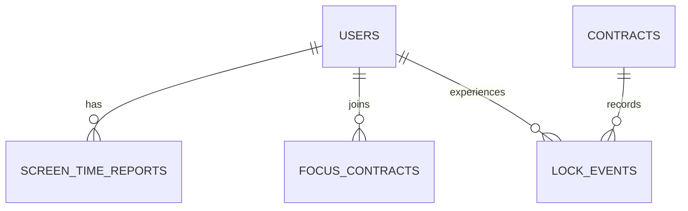

# 脚印 · 手机版需求文档（锁机 · 使用时长 · 督促系统）

> 需求文档 v0.1（增量）· 基于《[需求文档.md](<需求文档.md>)》的 Web 版功能扩展
> 本文档是**增量说明**，只写新增/变更内容；未提及的部分沿用 Web 版规则。

| 项目 | 内容 |
|---|---|
| 文档版本 | v0.1（手机版增量） |
| 日期 | 2026-11-02 |
| 状态 | 待评审 |
| 形态 | **原生移动 App**（iOS / Android），配套后端服务 |
| 定位 | 在原「双人打卡 + 积分 + 愿望单」基础上，新增**真实场景约束**：看得见的手机使用时长 + 系统级锁机 + 连坐互督 |

---

## 目录

1. [背景与要解决的新痛点](#1-背景与要解决的新痛点)
2. [与 Web 版的关系](#2-与-web-版的关系)
3. [形态与平台](#3-形态与平台)
4. [手机使用时长（可见度）](#4-手机使用时长可见度)
5. [锁机系统](#5-锁机系统)
6. [连坐互督（督促系统）](#6-连坐互督督促系统)
7. [与积分 / 软惩罚体系的衔接](#7-与积分--软惩罚体系的衔接)
8. [权限与合规](#8-权限与合规)
9. [新增数据模型](#9-新增数据模型)
10. [新增通知](#10-新增通知)
11. [非功能性需求（增量）](#11-非功能性需求增量)
12. [版本规划（增量）](#12-版本规划增量)
13. [明确不做的事（增量）](#13-明确不做的事增量)
14. [待拍板清单（增量）](#14-待拍板清单增量)
15. [参考来源](#15-参考来源)

---

## 1. 背景与要解决的新痛点

Web 版的 [痛点表](#14-要解决的真实痛点) 里，"监督变成催命"那一行说的是：系统承接提醒，人只负责验收。但那只解决了**"打卡有没有做"**。还有一个 Web 版摸不到的层面——**"人是不是真的把该专注的时间用在了手机上"**。

手机上最大的自律黑洞是：你在刷短视频、刷社交，但"今天打卡做完了"这件事本身没有暴露这一点。

手机版要补的是**两把钥匙**（对应 Web 版三支柱中"目标"的延伸，以及[监督者]能力的强化）：

1. **可见度**：对方能看到我的屏幕使用时长 / 各 App 用时 / 解锁次数 / 时长趋势。让"刷手机"这件事也被看见，不是偷偷发生。
2. **约束**：两人可以约定"一段时间内禁用某些 App"，用系统级锁机+连坐，让放弃有真实成本。

> 一句话：Web 版解决"打卡没做"，手机版再解决"时间浪费在手机上"。

---

## 2. 与 Web 版的关系

- 手机版**不是替换** Web 版，而是**它的客户端 + 增强**。打卡、积分、愿望单、验收等全部沿用 Web 后端与数据模型。
- 手机版**新增三类 Web 版做不了的能力**：读取系统使用时长（UsageStats / 屏幕使用时间）、系统级应用屏蔽（锁机）、本机通知。这三类必须原生 App 实现。
- 双端**同一套账号**（Web 与 App 登录同一后端），进度、积分、流水完全互通。
- 后端**新增少量接口与表**（第 9 节），其余逻辑不变。

---

## 3. 形态与平台

| 项 | 决策 |
|---|---|
| 首选平台 | **Android**（锁机 / 时长 / 无障碍能力最成熟，也是用户所说"搭子计划"的主平台） |
| 次选 | iOS（用屏幕使用时间 / 引导访问，能力受限，见 8.2） |
| Web 兜底 | 无法/不愿装 App 的一方，仍可用 Web 正常打卡，只是看不到也不发起锁机 |
| 跨平台互督 | 允许 Android 与 iOS 配对，锁机能力以能力强的一方为准（见 5.4） |

> 原 Web 文档第 15 节"明确不做"里写了"移动 App（原生）不上异步"。**本条目的本意是"Web 足够、不值得为移动做原生"**。手机版需求的到来正是为了让"真实锁机 + 使用时长"这种只有原生能做到的能力落地，因此**推翻那条**，改为：基础打卡用 Web/App 皆可，锁机与时长必须 App。

---

## 4. 手机使用时长（可见度）

### 4.1 数据来源与采集

| 平台 | 数据源 | 说明 |
|---|---|---|
| Android | `UsageStatsManager` + `AccessibilityService`（时钟/前台 App 精确到秒） | 需用户在系统设置授权"使用情况访问"。能拿到**各 App 每日使用时长、解锁次数、解锁时刻**。 |
| iOS | 屏幕使用时间（DeviceActivity / FamilyControls） | 能拿到按类别/按 App 的使用汇总，精确度低于 Android，且需用户手动授权"与家人共享"或提供屏幕使用时间分享。 |

### 4.2 对方能看到什么（可见度原则 P2 的延伸）

默认**完全可见**（对齐 Web 版 P2），但做**粒度分级**：

| 可见内容 | 默认 | 可调 |
|---|---|---|
| 今日总屏幕时长 | 可见 | — |
| 今日解锁次数 | 可见 | — |
| 各 App 单日使用时长（按"应用类别"聚合） | 可见 | 敏感 App 可设"仅显示总时长" |
| 7 天总量趋势折线 | 可见 | — |
| 崩溃数据（睡前总时长、最长连续使用段） | 可见 | — |

**对齐 Web 版理念**：数据默认透明，不隐藏；但不设计成"窥探明细"——只给"这家伙今天刷了多久、大概刷什么"的诚实画面，不细到每一条操作。**单条浏览记录不做（见 13）**。

### 4.3 更新频率

- 本地每 5 分钟采集一次，离线缓冲；
- 每次 App 打开 + 每天 22:00 定时上报到后端；
- 对方页面拉取时展示"上次同步时间"，差异 > 15 分钟会显示"对方最近一次同步于 HH:mm"。

### 4.4 自我记录的价值

使用时长不只是给对方看，也让本人**看见自己**。手机版首页给每个用户两栏：**"我今天想让手机花在哪" vs "实际花在哪"**——把 Web 版"目标"量化到时间维度。

---

## 5. 锁机系统

### 5.1 两种锁

| 锁 | 对象 | 时长 | 说明 |
|---|---|---|---|
| **个人锁机** | 只看自己 | 自定义 | 先满足单人自律，不需要对方参与 |
| **双人契约锁** | 两人一起 | 双方确认 | 核心功能，见 5.2 |

### 5.2 双人契约锁（核心流程）

```
A 发起：选屏蔽App + 起止时间 + 时长 ──→ B 收到邀请
  →  双方各自确认 + 各自校验系统锁权限就绪
  →  到点系统级自动屏蔽（杀后台也生效）
  →  倒计时期间：一人提前退出 → 「连坐」双方都记失败（见 5.5）
  →  坚持到底 → 生成战绩（荣誉/耻辱卡），双方都得分
```

实现要点：

1. **双方都确认**才算生效（不能被单方单方面拉入锁机）。
2. 锁机时长与屏蔽 App（按类别，如"短视频 / 娱乐 / 社交媒体"）由发起方选，但**接收方可见且可改**，双方一致后生效。
3. 到点由系统调度**自动启锁**，不依赖 App 前台运行（对照专注契约"杀后台仍可靠启动"）。

### 5.3 系统级屏蔽的实现（Android）

| 手段 | 强度 | 说明 |
|---|---|---|
| 无障碍服务（拦截 / 屏蔽指定 App 启动） | 强 | 主流"应用锁"做法 |
| 数字健康 / 应用使用限制（`AppOpsManager` / 设备策略） | 强 | 系统级，较稳定 |
| 距离传感器 / 计时土壤（防退出） | 辅助 | 阻止"就退出几秒"作弊 |

可选三档强度（可调，默认中）：

- **温和**：仅提醒"该专注了"，不强制拦截。
- **标准**：拦截分心 App（点开会提示"你在专注期"，可申请提前结束需对方同意）。
- **严格**：连坐锁机，屏蔽 App 无法打开，退出需双方同意。

> 借鉴[专注契约 FocusVow](https://focus.freeshore.cn/blog/what-is.html)："系统级强制锁机 + 一人退出双方失败 + 可分享战绩卡片"，但把它的**真金/硬核向**做成和 Web 版一致的**软约束**（见第 7 节）。

### 5.4 跨平台/强弱不对称

- 若一方 Android（强锁）、一方 iOS（只能提醒/引导访问），则锁机达成"在不破坏对方持有锁力的情况下，以最强可用机制为准"，iOS 侧展示能力不足的说明。
- **不强锁弱势平台**——宁可在 iOS 端降级为"提醒锁"，也不造一个对方根本拦不住的假承诺。

### 5.5 连坐机制（一人退出双方都记失败）

| 触发 | 后果 |
|---|---|
| 一方提前退出锁机 | 双方本次契约都记**失败**，各自**没得到**本次契约的锁机积分 |
| 坚坚持到底 | 双方都得**成功积分** + 生成战绩卡 |

> **关键对齐 Web 原则**：连坐"失败"**不扣存量分**，只是"这次没得到分"。失败双方都有记录（`契约失败次数`），不点名羞辱谁，只陈述事实（对应 Web P3、8.4"不扣存量"）。

---

## 6. 连坐互督（督促系统）

### 6.1 是什么

把 Web 版"监督者"角色的能力，从"看打卡"延伸到"看实时手机状态 + 共建锁机约定"。本质上是用**对方的眼睛**做外部约束，对冲"刷手机时的即时快感"。

### 6.2 督促机制清单

| 机制 | 说明 | 默认 |
|---|---|---|
| 互看实时状态 | 双方能看到对方当前是否在锁机期、今日已用屏幕时长 | 开启 |
| 契约锁机 | 见 5.2，共同进入屏蔽时段 | 双方发起 |
| 超出约定的警报 | 对方单日屏幕时长超过彼此约定的上限 → 触发提醒（不自动罚） | 开启可调 |
| 纪念 / 战绩 | 每次锁机成功生成可分享战绩卡，记录"两人一起坚持过" | 开启 |
| 约好一起专注 | 提供"此刻一起专注"入口，一方发起一方响应 | 开启 |

### 6.3 与"催命"的边界（对齐 Web 1.4）

Web 版说了"监督变成催命"的解法是**系统承接提醒，人只负责验收**。手机版同样遵守：

- 提醒由系统/约定自动触发，**不靠一方手动追问**"你有没有在刷手机"。
- 对方做的是**确认锁机契约、回应"一起专注"邀请**这类低摩擦动作，不是在当监督警察。

---

## 7. 与积分 / 软惩罚体系的衔接

### 7.1 新增记分项（只加正向积分，杜绝扣存量，对齐 P3）

| 动作 | 积分来源 | 备注 |
|---|---|---|
| 完成一次双人契约锁机全程 | + 固定分（可设 20–50） | 双方各得 |
| 单日屏幕时长低于两人设定的目标 | + 达成分 | 进入每日统计 |
| 连续 N 天锁机打卡 | 里程碑加分（复用连续链逻辑） | |

### 7.2 软惩罚（不扣存量）

| 情形 | 后果 | 默认 |
|---|---|---|
| 锁机中途退出（连坐失败） | 本次**没得到**锁机分；记「契约失败 +1」 | 开启 |
| 单日屏幕时长连续超限 3 天 | 兑换功能冻结 24h（复用 Web 8.2） | 开启可调 |
| 单日屏幕时长连续超限 7 天 | 目标转「待复盘」，对方需点"已复盘"才恢复 | 开启可调 |

> 全程没有"扣已有余额"，没有真金罚款，没有公开羞辱——延续 Web 版"系统敌人是放弃，不是偷懒"。

### 7.3 与愿望单的联动

- 可以把"锁机 / 时长目标"当作一个**阶段目标**挂到愿望单结算，例如："连续 14 天每天屏幕 < 3h → 兑换一双鞋"。
- 达成可兑换，逾期按 Web 版"只发 90%"规则。

---

## 8. 权限与合规

### 8.1 Android 权限清单

| 权限 | 用途 | 说明 |
|---|---|---|
| `PACKAGE_USAGE_STATS`（使用情况访问） | 读取各 App 使用时长 | 需用户在系统设置手动授权 |
| `BIND_ACCESSIBILITY_SERVICE`（无障碍） | 锁机拦截 / 前台识别 | 需明确告知用途，这是敏感权限 |
| 电池优化忽略 | 保证锁机调度不被打断 | |
| 通知权限 | 本机推送 | |

**权限必须可解释、可撤回**：设置页提供"对方能看到哪些数据"的明细，以及"一键停止共享使用时长"开关。

### 8.2 iOS 限制（如实说明，避免过度承诺）

- 锁机在 iOS 无法做到 Android 那种"系统级强制屏蔽第三方 App"，只能用**屏幕使用时间 / 引导访问 / 提醒**实现软锁。
- 使用时长分享在 iOS 支持度较低，需用户手动开启"屏幕使用时间"分享能力。
- **手机版需求按"能力可达"设计**：iOS 端明确标注"锁机为提醒级"，不承诺做不到的事（对应 skill 原则——不猜测、按官方能力设限）。

### 8.3 隐私与信任

- 使用时长与锁机数据为**两人专用**，不上第三方分析，不出可分享公链（数据仅双方可见）。
- 战绩卡默认可选发不发，不默认公开。

---

## 9. 新增数据模型

### 9.1 实体关系（新增部分）



### 9.2 新增表

**screen_time_reports**（每日上报）

| 字段 | 类型 | 说明 |
|---|---|---|
| id | int PK | |
| user_id | int FK | |
| report_date | date | |
| total_min | int | 当日总屏幕分钟 |
| unlock_count | int | 解锁次数 |
| app_usage | json | `{category: {app: minutes}}`，类别聚合 |
| first_sync_at / last_sync_at | datetime | 同步时间 |

**focus_contracts**（双人契约锁）

| 字段 | 类型 | 说明 |
|---|---|---|
| id | int PK | |
| initiator_id / acceptor_id | int FK | 发起 / 接受方 |
| start_at / end_at | datetime | |
| blocked_categories | json | 屏蔽应用类别列表 |
| mode | enum | `gentle` / `standard` / `strict` |
| status | enum | pending / active / completed_success / failed_early / cancelled |
| created_at | datetime | |

**lock_events**（单方锁定记录，含连坐判定）

| 字段 | 类型 | 说明 |
|---|---|---|
| id | int PK | |
| contract_id | int FK | |
| user_id | int FK | |
| early_exit | bool | 是否提前退出 |
| points | int | 本次实得（可能 0） |
| failed_streak_contrib | bool | 是否计入连坐失败 |
| 证据/战绩 | url | 生成的战绩卡（可选） |

**user_screen_limits**（彼此的时长约定）

| 字段 | 类型 | 说明 |
|---|---|---|
| id | int PK | |
| pair | 双方 user_id | 一对两人一份 |
| daily_limit_min | int | 单日限额 |
| alert_at_min | int | 触发提醒阈值 |
| active | bool | 是否启用 |

---

## 10. 新增通知（增量，追加到 Web 11.1）

| 事件 | 接收人 | 优先级 |
|---|---|---|
| 对方发起锁机契约邀请 | 对方 | 高 |
| 锁机即将开始（提前 5 分钟） | 双方 | 中 |
| 锁机提前退出（连坐失败） | 双方 | 高 |
| 锁机成功结束（战绩） | 双方 | 中 |
| 对方屏幕时长超约定阈值 | 劝说方+本人 | 低（不自动罚，仅提醒） |
| 对方使用时长 22:00 已同步 | 双方 | 低 |

> 沿用免打扰时段：23:00–07:00 不响系统铃，但红点仍更新；锁机契约邀请这类高优先级事件可突破免打扰弹系统通知。

---

## 11. 非功能性需求（增量）

| 项 | 要求 |
|---|---|
| 锁机可靠性 | Android 杀后台后锁机调度仍生效（对照[专注契约](https://focus.freeshore.cn/blog/faq.html)的做法） |
| 后台采集 | 5 分钟采集，离线缓冲，网络恢复补传 |
| 省电 | 使用时长采集接入系统限制，不显著增加耗电 |
| 跨端同步 | App 与 Web 用同一后端账号，实时状态 ≤ 30s 延迟 |
| 权限可逆 | 数据共享可一键停止，撤回后立即停止上报 |
| 时区 | 每天按本地时区切日 |

**原有 Web 13 节（SQLite、快照、备份、运维）沿用不变**；App 仅是后端的新客户端。

---

## 12. 版本规划（增量）

### M1 · 时长可见（先用起来）
- Android 使用时长采集 + 双方互看（总时长 / 解锁次数 / 类别聚合）
- 7 天趋势 / 首页"实际 vs 目标"
- 时长超阈提醒（不罚）

**验收**：同一账号 App「手机版」看得到自己与对方的真实时长，数据与系统设置基本一致。

### M2 · 个人锁机 + 双人契约锁
- 个人锁机（单人自律）
- 双人契约锁 + 连坐判定 + 战绩卡
- 锁机积分 + 软惩罚（不扣存量）

**验收**：两人共同进入锁机，一方退出双方都记失败，积分与 Web 流水一致；杀后台后锁机仍生效。

### M3 · iOS + 打磨
- iOS 屏幕使用时间接入（锁机降级为提醒级）
- 跨端互督、时长目标挂愿望单结算
- 权限可逆、隐私说明、免打扰

**验收**：App 与 Web 全流程互通，权限全部可撤回，30 天无数据丢失。

---

## 13. 明确不做的事（增量，追加到 Web 15）

| 不做 | 原因 |
|---|---|
| 单条浏览记录 / 逐应用打开明细（精确到秒的操作日志） | 过度窥探，违背"诚实但不过度"，且到手价值低 |
| 解锁 App 就能"干这事"的强制打扰 | 连坐锁机已覆盖，再加会变骚扰 |
| 公开排名 / 社交分享到朋友圈 | 隐私风险，且让锁机变成表演（对齐 Web 15） |
| 远程替对方解锁 / 单方结束别人的锁 | 必须双方，防止滥用 |
| 真金对赌 / 罚款 | 对齐 Web 8.4，系统敌人是放弃不是偷懒 |
| iOS 强锁（系统级屏蔽第三方 App） | iOS 系统不支持，如实提供提醒级 |

---

## 14. 待拍板清单（增量）

| # | 问题 | 我的倾向 | 默认值 |
|---|---|---|---|
| 1 | 是否推翻"不做原生 App"？ | **是**——锁机/时长只能原生做，满足"搭子计划式"约束必须 App | 做 Android 原生 App |
| 2 | iOS 锁机能力不足，是否接受"提醒级"？ | 接受，不强锁弱势平台 | iOS 软锁 |
| 3 | 使用时长"可见粒度"到 App 类别，还是要到具体 App？ | 类别聚合即可，避免过度窥探 | 类别聚合 |
| 4 | 双人契约锁需要双方确认，要不要允许"单人发起的随心锁"？（先自己锁，对方可见仅知情） | 增加"个人锁机"单选，双人契约才需确认 | 双人契约需确认；个人锁机随意 |
| 5 | 手机版是否作为独立 App 上架，还是先内测（TestFlight / 侧载）？ | **先内测**，只有两个人用，上架审核成本不值 | 内测分发 |
| 6 | 时长目标是否纳入"完备月"这类 Web 统计？ | 第一版纳入"今日/本周"，完备月统计先不加 | 纳入今日/本周 |

---

## 15. 参考来源

- 专注契约 FocusVow（搭子互督 + 连坐 + 系统级强制锁机）：[产品定义](https://focus.freeshore.cn/blog/what-is.html) · [FAQ](https://focus.freeshore.cn/blog/faq.html) —— 连坐机制、双人契约、战绩卡的直接参照
- Android `UsageStatsManager`（应用使用统计）：[UsageStatsManager | Android API](https://developer.android.com/reference/android/app/usage/UsageStatsManager) —— 使用时长数据源
- iOS 屏幕使用时间（DeviceActivity / FamilyControls）：[为家庭成员设置屏幕使用时间](https://support.apple.com/zh-hans/guide/iphone/iph7f15d92dd/16.0/ios/16.0#1) —— iOS 能力边界
- 双人对赌 + 证据 + AI 裁判：SweatEquity [README](https://raw.githubusercontent.com/sohan-shingade/sweatequity/main/README.md) —— 双人绑定 / 证据 / 对赌参照